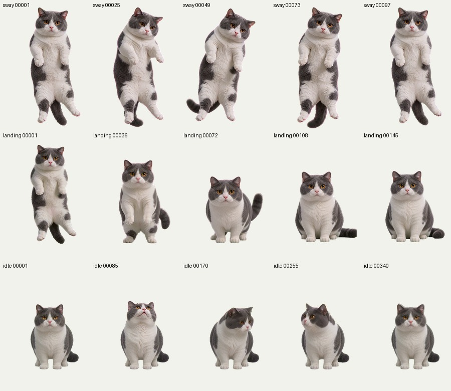

# Desktop Pet Builder

一个用于规划、制作和打包桌面宠物的 Codex Skill。它把动作选择、角色参考图、视频提示词、逐帧抠图与校准、交互状态和跨平台安装流程串成可复用的制作方法。

> 当前灰白猫桌宠作为示例项目，展示 Skill 如何把动作素材转成可交互的桌面宠物。此仓库包含 Skill、制作流程、案例介绍和小尺寸预览图；不包含原始视频、整套高分辨率帧素材或安装包。



## 两个明确的确认节点

1. **先选动作，再收集对应图片**：用户选择要做的动作后，Skill 再请求角色基准图与对应动作姿势图；图片齐全后，生成保持角色一致的提示词。
2. **接入或打包前选平台**：需要平台相关实现时，确认目标是 macOS、Windows 或两者。若当前对话已明确平台，不重复询问。

素材处理完成后，会先展示接触表和连续播放预览，确认通过再替换程序中的正式素材。

## 示例项目：灰白猫桌面宠物

这只短毛猫桌宠展示了完整动作组合：待机时根据鼠标方向转头；按住并拖动时循环摇摆；松开后加速落地并回到正面待机；键盘输入期间踩奶，长按持续播放，敲击节奏影响动作速度。程序还提供等比例大小选项、猫咪头像图标和登录启动入口。

案例介绍和动作说明：[examples/cat-desktop-pet/README.md](examples/cat-desktop-pet/README.md)

## 安装 Skill

将仓库克隆到 Codex Skills 目录：

```sh
git clone https://github.com/lwh437698709-hub/desktop-pet-builder.git ~/.codex/skills/desktop-pet-builder
```

然后在 Codex 中调用：

```text
$desktop-pet-builder 帮我制作一只桌面宠物
```

## 内容结构

- `SKILL.md`：动作和平台确认节点、核心制作规则。
- `references/desktop-pet-production-workflow.md`：从素材准备到安装验收的完整流程。
- `examples/cat-desktop-pet/`：本次灰白猫桌宠的项目介绍与预览图。

## 当前范围

这个仓库提供可复用制作方法和示例介绍，不提供桌宠安装包或高分辨率视频素材。Windows x64 安装流程已构建；发布给其他 Windows 设备前，还应在 Windows 10/11 实机完成安装、升级、快捷方式、登录自启和键盘监控验证。代码签名证书和许可证尚未纳入本仓库。
