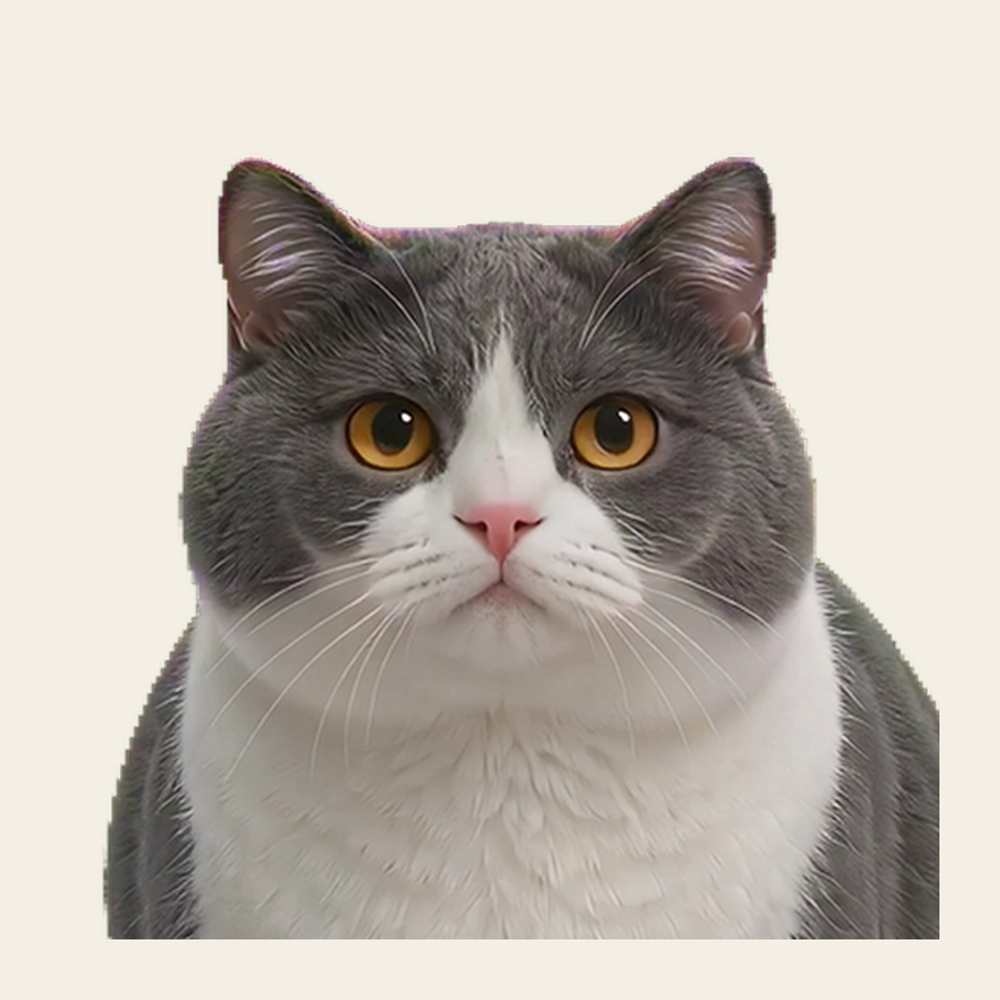
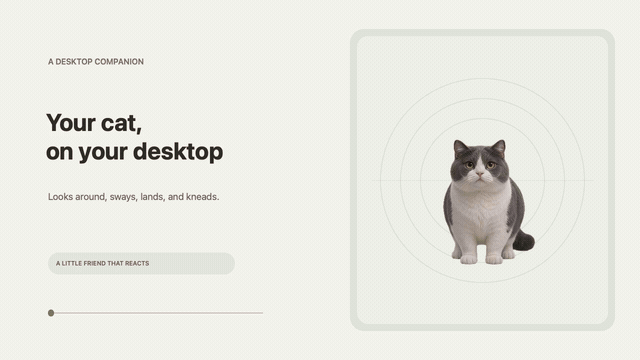
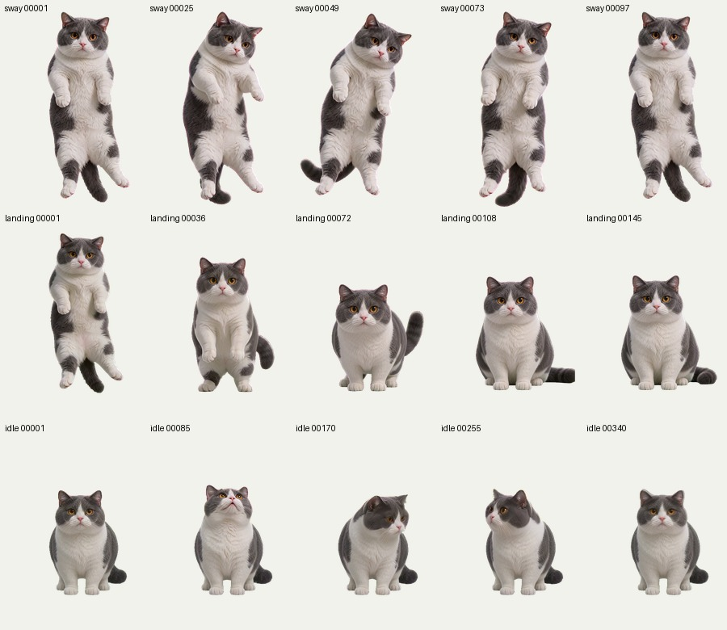

# 灰白猫桌面宠物

一只能够感知桌面鼠标和键盘活动的灰白短毛猫。它以用户提供的全身形象为外观基准，保留圆脸、灰白花色、金黄色眼睛和短毛质感；动作素材统一透明画布、头部尺度和定位锚点，避免状态切换时猫咪忽大忽小或身体错位。

## 动作演示

[下载完整动作演示视频（MP4，1280×720）](desktop-pet-demo.mp4)

## 动作体验

- **待机看向鼠标**：根据鼠标在桌面上的方向切换视线帧；方向序列闭环播放。
- **被提起与拖动**：按住猫咪头部拖动；摇摆动画循环播放，鼠标松开后进入落地转场。
- **落地回待机**：落地素材以更快速度播放，选择和正面待机姿态接近的末帧，落地后先正视屏幕。
- **键盘踩奶**：按键后触发踩奶；持续按住时维持动画，输入节奏调节播放速度，停止输入后淡回待机。
- **桌面设置**：可选择“大弟弟”原尺寸和“小弟弟”50% 等比例缩放；程序图标使用猫咪头像，并支持登录后自动启动。

## 制作方法

1. 先定义角色外观和动作状态，再按动作选择收集姿态参考图。
2. 从高分辨率视频抽帧，制作编号接触表；逐帧检查耳朵、胡须、爪子、尾巴和键盘道具边缘。
3. 使用稳定的抠图参数与边界规则修复问题帧；按头部大小和锚点把动作放入相同透明画布，只做等比例缩放和平移。
4. 检查整段连续播放与状态过渡，得到用户确认后再把素材接入桌宠。
5. 在平台实现状态机、输入监控、大小选项、头像图标和自动启动；打包前确认 macOS/Windows 目标。

## 平台状态

- **macOS 预览版**：用于本机快速体验鼠标动作和键盘踩奶；跨应用键盘监听需要系统辅助功能授权。
- **Windows x64**：提供面向 Windows 10/11 的自包含 MSI 构建方案，使用低级键盘钩子监听按下/松开时序，不读取按键字符。

本示例仓库不附带程序二进制、原始视频或高分辨率帧文件。当前 Windows 安装包在 macOS 上构建；面向发布前仍需在 Windows 10/11 实机验收安装、升级、登录自启、快捷方式和键盘监控。
